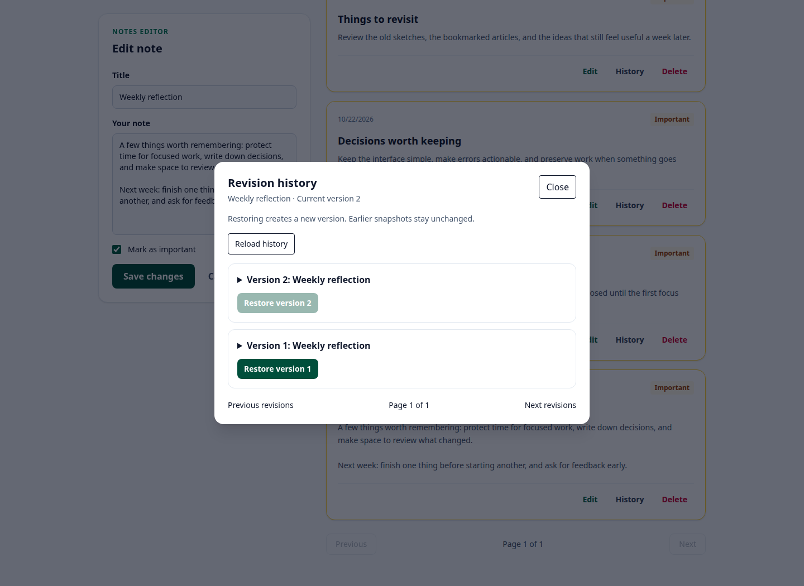

# Notes · Laravel 13 API + React SPA

A private notebook built with **Laravel 13, PHP 8.4, React 19, Tailwind CSS 4, and Vite 6**. React talks to a versioned Laravel API using same-origin session cookies.


## Application features

- Registration, sign-in/out, and password recovery with expiring, single-use tokens.
- Create, edit, delete, search, and mark notes as important.
- Owner-scoped queries and policies, including authorization inside domain actions.
- Ten notes per page, bounded API pagination, deterministic ordering, and debounced search.
- Atomic version checks for edits, deletes, and restores; conflicts return HTTP 409.
- Private revision snapshots and restoration as a new version, without rewriting earlier snapshots.
- Preserved editor drafts, explicit discard confirmation, and recovery after conflicts or session expiry.
- Responsive React forms, accessible labels, history dialog focus handling, and request feedback.
- Shared validation rules, Form Requests, API Resources, focused invokable actions, and development lazy-loading protection.
- Factories, optional demo data, Pest/PHPUnit regressions, frontend unit tests, and Chromium/axe checks.

## Run locally with Docker Compose

Docker Engine and Compose are the only requirements for running the app. PHP, Composer, Node, and asset compilation run inside the image.

```bash
git clone git@github.com:dionis1/notes-app.git
cd notes-app
docker compose up --build -d
```

Open [http://localhost:8000](http://localhost:8000). Prefix Docker commands with `sudo` if required on your PC. Compose runs one app container, applies additive migrations at startup, and persists SQLite, sessions, logs, and the local encryption key in a named volume. Rebuild after changing source code.

```bash
# Inspect startup:
docker compose ps
docker compose logs --tail=50 app

# Stop and free the container's RAM, keeping data:
docker compose down

# Restart:
docker compose up -d

# If another app uses port 8000:
APP_PORT=8001 docker compose up -d
```

**`docker compose down -v` deletes the notes volume and local key.** Back up existing databases before migrating. Legacy notes without an owner remain hidden; the application never assigns them to a newly registered user.

Docker is for local use. CI and deployment tooling are not included.

## Demo notebook and factories

Startup does not create demo accounts. Add them explicitly:

```bash
docker compose exec app php artisan db:seed --class=DemoSeeder
```

| Notebook | Email | Password |
| --- | --- | --- |
| Writer: 12 notes, four important, and example revision history | `writer@demo.notes.test` | `NotesDemo!2026` |
| Separate private notebook | `other@demo.notes.test` | `NotesDemo!2026` |

The public demo credentials are for local use only. The seeder refuses environments other than `local` and `testing`. It creates the dataset transactionally through the application actions. Existing accounts are skipped entirely, so reruns preserve edited titles, passwords, and deleted demo notes. To refill an existing notebook, create records normally or use factories in an isolated database. `php artisan db:seed` calls the same demo seeder.

`UserFactory` and `NoteFactory` provide Faker fixtures. Factories insert records directly; use the note actions when fixtures also need validation and revision history.




## Tests and checks

```bash
# PHP/Pest regressions, isolated from personal notes:
docker compose exec app php artisan test

# PHP formatting and locked dependencies:
docker compose exec app vendor/bin/pint --test
docker compose exec app composer audit --locked

# Frontend unit tests/build with Docker:
docker build --target assets -t notes-frontend:local .
docker run --rm notes-frontend:local npm run test:unit
docker run --rm notes-frontend:local npm audit
```

PHP tests force an in-memory database, test encryption key, and isolated session/cache/mail settings even inside the Compose app. Tests cover ownership, direct-action authorization, rollback after snapshot failures, stale updates/deletes/restores, immutable history, deletion cascades, legacy records, credential boundaries, password-reset expiry/reuse, pagination, and non-destructive seeding.

### Browser checks

Build the app image first. With Node 22 and npm available on the PC:

```bash
npm ci
npx playwright install chromium
npm run test:browser

# Or use installed Chrome:
CHROME_BIN=/usr/bin/google-chrome npm run test:browser
```

The runner starts and removes a separate Docker container on port 8010, with an internal disposable database and no personal-volume mount. It refuses to reuse another running server. Browser checks cover CRUD, search/filtering, independent-account privacy, mobile overflow, axe accessibility findings, revision restore, keyboard focus, conflict/draft recovery, session expiry, and cross-site forgery protection.

Test artifacts are written under `test-results`, separately from README images. Automated checks do not replace manual accessibility review.

To recreate the screenshots from an untouched demo dataset:

```bash
SCREENSHOT_URL=http://127.0.0.1:8000 CHROME_BIN=/usr/bin/google-chrome node scripts/capture-screenshots.mjs
```

## Authentication and API

Register an account or use the optional demo writer. Reset links are written to the local Laravel log; no external mail provider is configured:

```bash
docker compose exec app tail -n 100 storage/logs/laravel.log
```

Keep reset links private. The React client requests `/sanctum/csrf-cookie` and uses cookies plus CSRF headers. Business data lives under `/api/v1/notes`; all note and revision reads are scoped to the authenticated owner.

See the [API contract](docs/API.md), [architecture decisions](docs/ARCHITECTURE.md), and [application security notes](docs/SECURITY.md).

## Versions and scope

The lock files resolve stable Laravel 13, React 19, and Tailwind 4 releases. This iteration keeps that stack. SQLite is the verified database. Leading-wildcard substring search is intended for small personal notebooks; no large-dataset or MySQL/PostgreSQL performance claim is made.

Separate tabs do not receive pushed updates; conflicts are detected when writing. Unsaved drafts stay in browser memory per account, and are cleared on explicit sign-out or a full page reload/close. The browser warns before leaving a dirty editor. Drafts are not written to localStorage. Revision history starts at creation or the first edit of an older note; it cannot reconstruct earlier versions. Permanent deletion also removes that note's history. Notes are access-controlled, not end-to-end encrypted.

## Mobile editor


