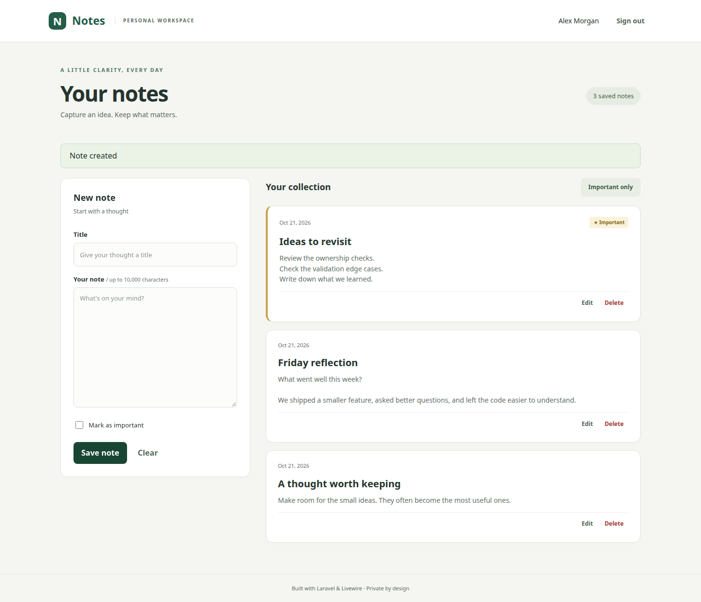
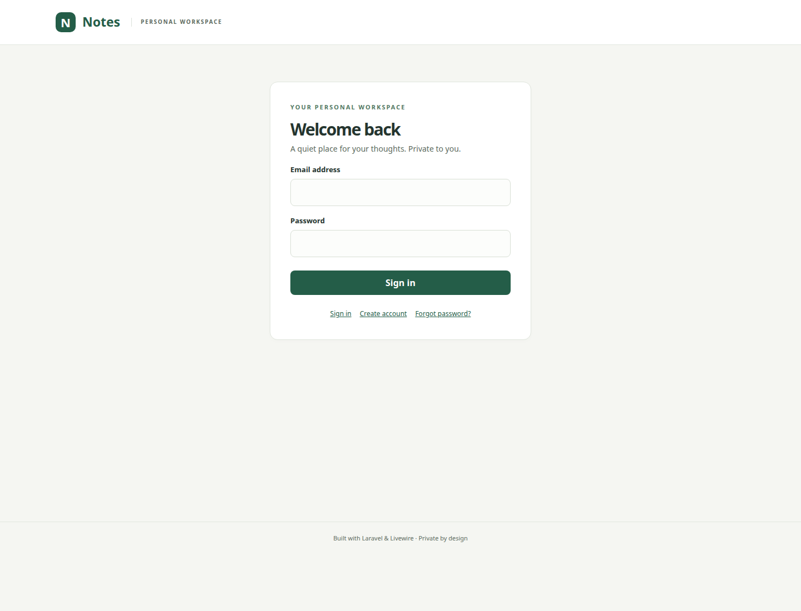
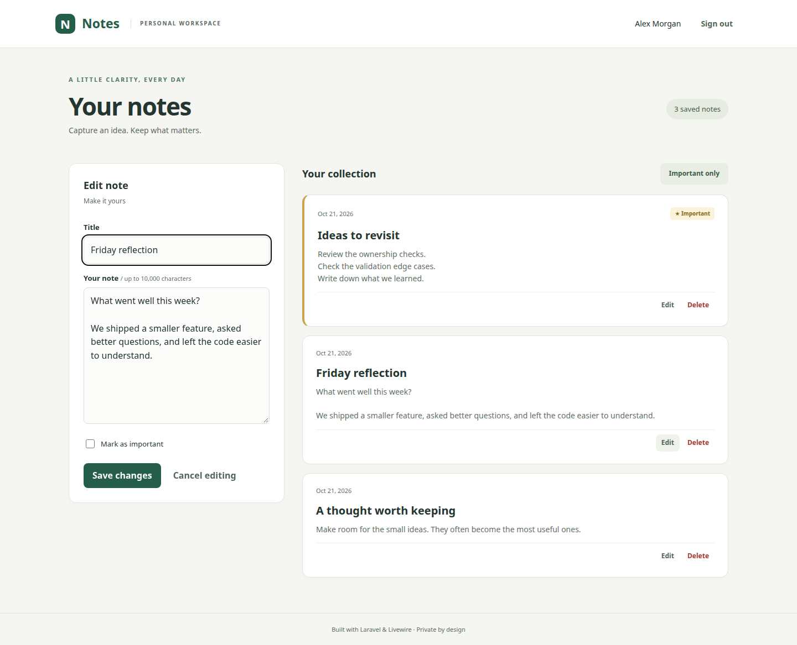
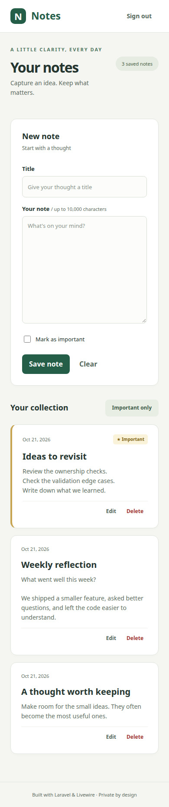

# Notes · Laravel & Livewire

A private notes application focused on Laravel development: authentication, authorization, validation, reactive forms, and tested data handling. Docker provides a simple way to run it on your PC.



## Features

- Register, sign in, sign out, and reset your password.
- Create, edit, delete, and mark notes as important.
- Private notes with ownership-scoped queries and authorization policies.
- Important-only filtering and pagination (10 notes per page).
- Locked Livewire IDs and atomic version checks for safe edits and deletes.
- Preserved drafts when a record changes or is deleted in another session.
- Bounded validation, escaped output, authentication throttling, and CSRF protection.
- Responsive forms with accessible labels, edit focus, delete confirmation, and request failure feedback.
- Local CSS/JS assets, PHP feature tests, browser tests, and PHP static analysis.

Livewire updates the current page through HTTP requests without reloading it. Separate browsers do not receive pushed updates; conflicting writes are detected when saving.

## Laravel has not been upgraded

**Laravel remains pinned to its original version, 10.49.1.** Compatible dependencies were updated, but Laravel 10 security support ended on 4 February 2025. Four Composer advisory entries remain in Laravel itself, including overlapping entries for an email-validation issue.

This is a local learning/portfolio application, not a claim of current framework support or a clean Composer audit. See [known security limitations](docs/SECURITY.md), the [audit snapshot](docs/composer-audit.json), and the [official support table](https://laravel.com/framework/docs/10.x/releases). A future framework upgrade is still needed.

## Run on your PC with Docker

Requirements: Docker Engine and Docker Compose. You do not need PHP, Composer, Node, or a database server installed on your PC.

```bash
git clone https://github.com/dionis1/notes-app.git
cd notes-app
docker compose up --build -d
```

Open [http://localhost:8000](http://localhost:8000) and create your account. The first build may take several minutes. If your machine requires it, prefix Docker commands with `sudo`.

```bash
# Check the app and its startup logs:
docker compose ps
docker compose logs --tail=50 app

# Run the Laravel tests inside Docker:
docker compose exec app php artisan test

# Stop the application while preserving your notes:
docker compose down
```

Notes, sessions, and the generated local key persist in a named volume. **`docker compose down -v` deletes that data.** The app binds to localhost only. Rebuild after code changes. For another port:

```bash
APP_PORT=8001 docker compose up --build -d
```

Password reset links are logged locally instead of emailed. Request a reset and inspect `docker compose logs app`; keep those links private. There is no seeded account or default password.

## Run with local PHP

Requirements: PHP 8.2 with PDO SQLite, mbstring and DOM/XML, Composer 2, and Node 22.

```bash
composer install
npm ci
cp .env.example .env
php artisan key:generate
touch storage/app/notes.sqlite
php artisan migrate
npm run build
php artisan serve
```

Open [http://localhost:8000](http://localhost:8000). For CSS/JS development, run `npm run dev` in a second terminal. `.env.example` uses SQLite and log mail.

## Tests and code checks

```bash
php artisan test
vendor/bin/pint --test
vendor/bin/phpstan analyse --no-progress
npm run build
composer audit
npm audit
```

`composer audit` currently reports the known Laravel findings described above. The test configuration explicitly overrides both environment and server values so tests use SQLite in memory, array sessions, and a test-only key even when Docker has different settings.

The PHP suite covers authentication and recovery, session revocation, throttling, ownership, forged IDs, locked properties, validation limits, filtering, pagination, escaping, concurrent edits, and deleted records. Browser checks exercise registration, CRUD, filtering, reload persistence, account isolation, logout, CSRF rejection, mobile overflow, and serious/critical accessibility findings.

To run the browser tests with local PHP:

```bash
npx playwright install --with-deps chromium
npm run test:browser
```

Or use an installed Chrome: `CHROME_BIN=/usr/bin/google-chrome npm run test:browser`. The tests start a separate server on port 8010 and reset only `/tmp/notes-browser.sqlite`. That database is disposable. Screenshots are captured from the browser test with synthetic account and note data. Automated accessibility checks do not replace manual keyboard and screen-reader testing.

## Screenshots

### Sign in



### Edit a note



### Mobile



## Laravel structure

- `app/Livewire/Notes.php`: validated form state, filtering, pagination, and user feedback.
- `app/Services/NoteService.php`: owner-scoped lookups and atomic version-aware mutations.
- `app/Policies/NotePolicy.php`: explicit authorization checks.
- `app/Http/Controllers/AuthController.php`: account, session, and password recovery flows.
- `tests/Feature`: database-backed Laravel and Livewire tests.
- `tests/Browser`: real browser interaction and accessibility checks.

See [Laravel design decisions](docs/ARCHITECTURE.md) for the reasoning behind those boundaries.

Anonymous notes from the original schema remain unowned and invisible after migration. An operator must verify ownership before assigning them; registration never automatically claims old notes.

## License

[MIT](LICENSE).
